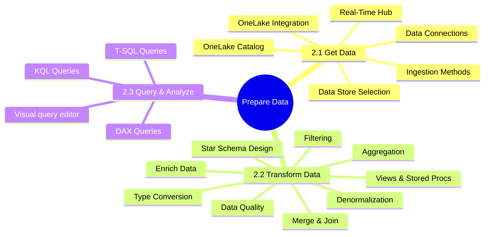
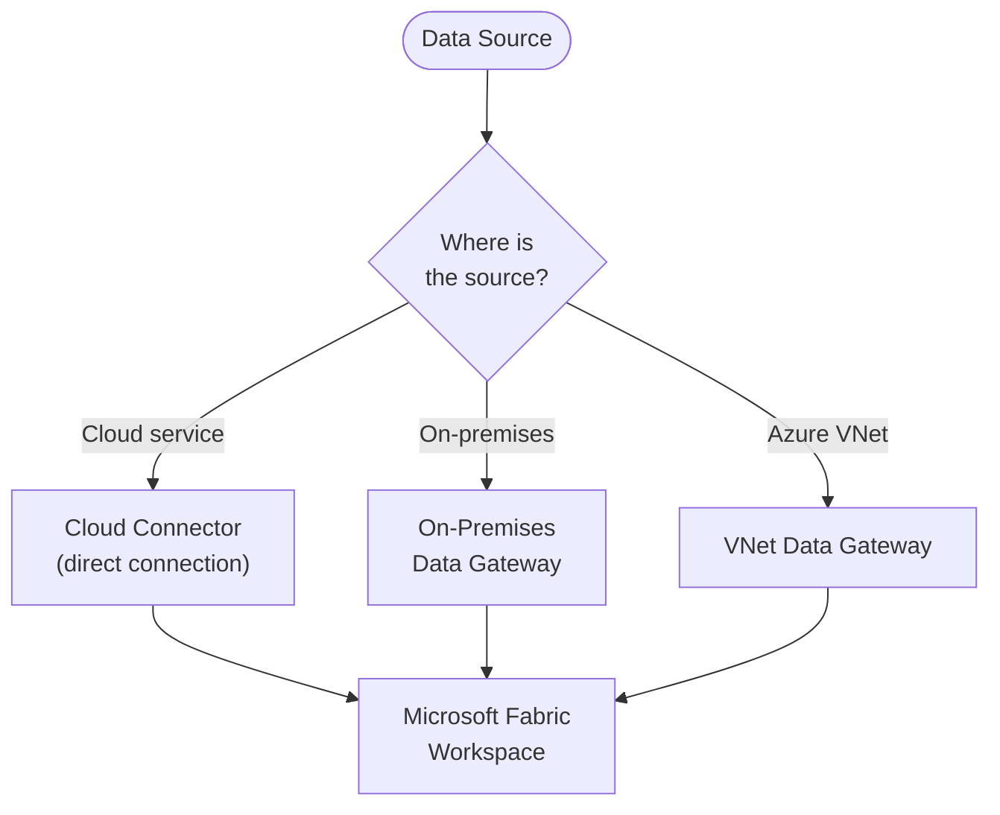
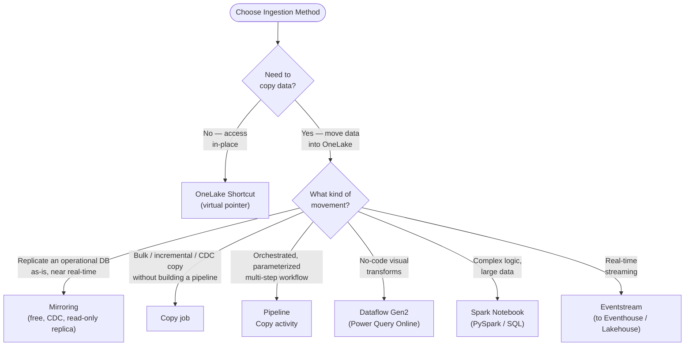
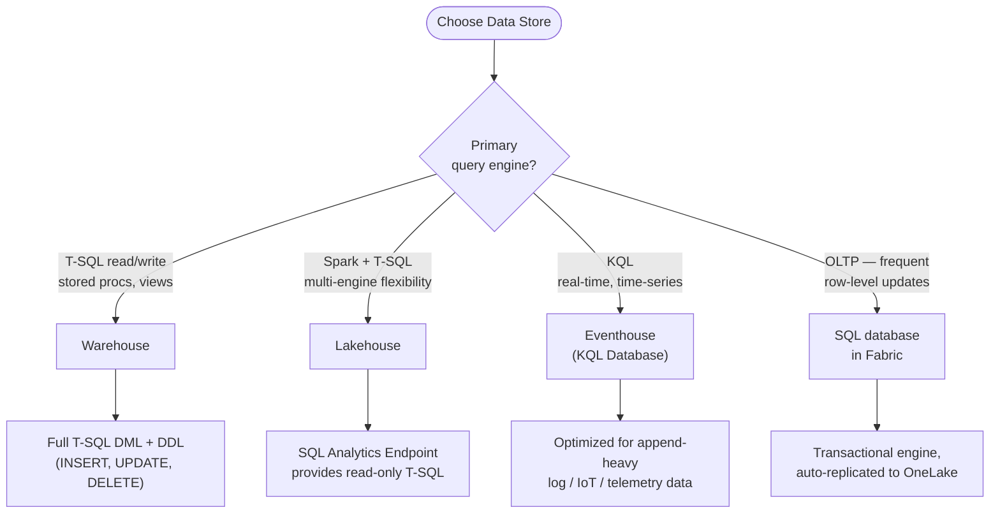
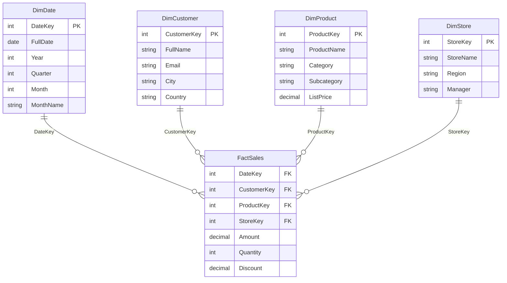
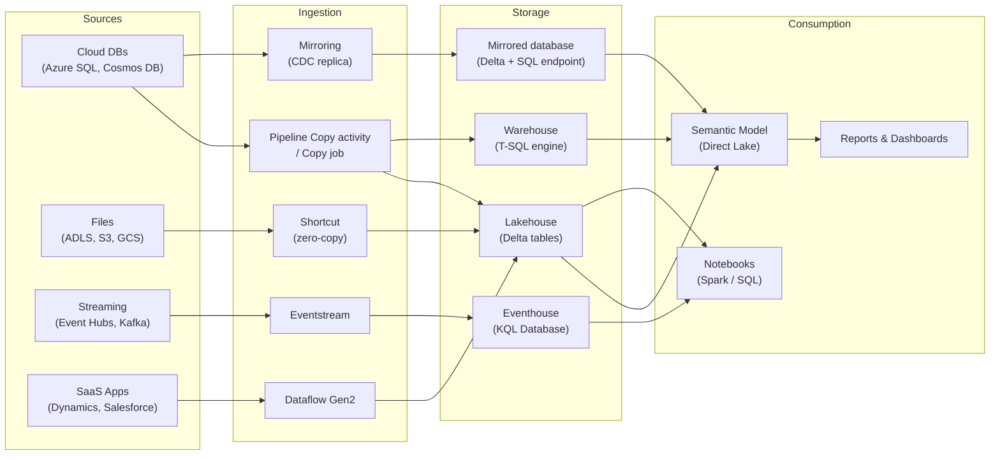

# 🔄 02 — Prepare Data
{: .no_toc }

> - Based on: *Microsoft Fabric documentation* (Microsoft Learn)
> - 📁 [← Back to Home](/dp-600-study-notes/)

Domain 2 is the heaviest weighted on the DP-600 exam, covering **45–50%** of the questions. This domain tests your ability to connect to data sources, discover data using OneLake catalog, choose appropriate data stores (lakehouse, warehouse, eventhouse, SQL database), and perform data transformations using SQL, KQL, and DAX.

<details open markdown="block">
  <summary>Table of contents</summary>
  {: .text-delta }
- TOC
{:toc}
</details>

---

## 📊 Domain Overview



---

## 📥 2.1 Get Data

### 🔌 Create a Data Connection

Data connections in Microsoft Fabric link workspaces to external or internal sources. The two primary components are **connectors** and **gateways**.

| Component | Purpose | When to Use |
|-----------|---------|-------------|
| **Cloud connectors** | Direct connection to cloud services (Azure SQL, ADLS Gen2, Dataverse) | Source is publicly accessible or within Azure |
| **On-premises data gateway** | Encrypted bridge between on-prem data and Fabric | Source is behind a firewall or on a private network |
| **VNet data gateway** | Connects to data sources within an Azure VNet | Source is in a private VNet (no on-prem agent needed) |
| **Personal gateway** | Single-user gateway for development/testing | Prototyping only; not recommended for production |



> **Exam Caveat:** The on-premises data gateway requires installation on a local machine and must be registered in the Fabric admin portal. A **VNet data gateway** does NOT require a local installation — it runs as an Azure-managed service inside the VNet.
{: .warning }

> **Exam Tip:** If the question mentions a data source inside an Azure Virtual Network, the answer is **VNet data gateway** — not the on-premises gateway.
{: .note }

---

### 🔎 Discover Data by Using OneLake Catalog and Real-Time Hub

**OneLake catalog** (formerly OneLake data hub) is the centralized discovery experience where users browse, search, and access the Fabric items they have permission to see across the tenant. Its **Explore** tab is for finding and using data; its **Govern** tab is where data owners review and govern the items they own.

| Feature | OneLake Catalog | Real-Time Hub |
|---------|----------------|---------------|
| **Purpose** | Discover lakehouses, warehouses, semantic models, reports | Discover and connect to real-time data streams |
| **Data type** | Batch and stored data | Streaming and event data |
| **Sources** | Fabric items across workspaces | Event Hubs, Eventstreams, CDC streams, custom apps |
| **Action** | Open, connect, or create shortcuts | Subscribe, route to Eventhouse or Lakehouse |

> **Exam Tip:** OneLake catalog lists **every item you can access** — endorsed items are badged and can be filtered so trusted data is easy to find. Know the three badges: **Promoted** = self-service, anyone with write permission; **Certified** = meets org quality standards, admin-authorized reviewers only; **Master data** = authoritative single source of truth (data items only), admin-authorized users only.
{: .note }

---

### 📤 Ingest or Access Data as Needed



#### Ingestion Methods Comparison

| Method | Code Required | Best For | Scheduling | Transform Capability |
|--------|:------------:|----------|:----------:|---------------------|
| **Mirroring** | ❌ | Continuous replica of a database (Azure SQL, Cosmos DB, Snowflake, …) for analytics | Continuous (CDC) | None — read-only Delta replica with a SQL analytics endpoint; **free** replication |
| **Copy job** | ❌ | Bulk, watermark-based incremental, or CDC copy across many sources/destinations — no pipeline needed | ✅ (built-in schedule) | Low (mapping, append/upsert/overwrite) |
| **Copy activity (Pipeline)** | ❌ | Orchestrated, metadata-driven ingestion with dependencies and error handling | ✅ (triggers, schedule) | Low (column mapping, user-defined source query) |
| **Dataflow Gen2** | ❌ (M / Power Query) | Self-service, moderate transforms | ✅ (own schedule or pipeline) | Rich (Power Query) |
| **Spark Notebook** | ✅ (PySpark, Spark SQL) | Complex transforms, ML, large data | ✅ (pipeline, schedule) | Full programmatic control |
| **Shortcut** | ❌ | Zero-copy access to ADLS, S3, GCS, Dataverse, other lakehouses | N/A (live pointer) | None (query at read time) |
| **Eventstream** | ❌ | Real-time ingestion from Event Hubs, Kafka, CDC feeds | Continuous | Inline (no-code) stream transforms |

> **Exam Tip:** Microsoft's own decision guide: **Mirroring** for "just get the (already curated) operational data into Fabric" (free, minimal setup); **Copy job** as the default for raw/bronze ingestion that needs incremental or CDC loads; **pipelines with Copy activity** when you need orchestration; **Eventstreams** for streaming.
{: .note }

> **Exam Caveat:** Shortcuts do NOT copy data — they create a virtual pointer. This means shortcut data is NOT included in lakehouse OPTIMIZE or VACUUM operations. For exam questions about reducing data duplication, shortcuts are the answer.
{: .warning }

> **Exam Caveat:** **Dataflow Gen2** can write to many destinations — Lakehouse tables or files, Warehouse, KQL database, Fabric SQL database, Azure SQL, Azure Data Explorer, ADLS Gen2, SharePoint files, Snowflake, and more. **Dataflow Gen1** (legacy) keeps its output in its own internal storage, consumed through the dataflows connector. The exam tests Gen2.
{: .warning }

---

### ⚖️ Choose Between Different Data Stores

This is a critical decision tree tested heavily on the exam.



#### Data Store Selection Matrix

| Criterion | Lakehouse | Warehouse | Eventhouse (KQL DB) | SQL database |
|-----------|:---------:|:---------:|:-------------------:|:------------:|
| **Engine** | Spark + SQL Analytics Endpoint | Full T-SQL | KQL (plus a T-SQL subset) | T-SQL (Azure SQL engine) |
| **Write via T-SQL** | ❌ (read-only endpoint) | ✅ (INSERT, UPDATE, DELETE, MERGE) | ❌ | ✅ |
| **Write via Spark** | ✅ | ❌ | ❌ | ❌ |
| **Storage / OneLake** | Delta (Parquet) in OneLake | Delta (Parquet) in OneLake (T-SQL–managed) | Columnar (KQL engine); Delta copy in OneLake is **opt-in** | Row store, **auto-mirrored** to Delta in OneLake |
| **Schema enforcement** | Schema-on-read or schema-on-write | Schema-on-write (strict) | Schema-on-write | Schema-on-write, enforced constraints |
| **Unstructured files** | ✅ (Files/ folder) | ❌ | ❌ | ❌ |
| **Best for** | Data engineering, ML, flexible ETL | Enterprise DW, SQL-heavy BI, multi-table transactions | Real-time analytics, logs, IoT | Operational/OLTP apps, selective lookups |

> **Exam Tip:** Microsoft's data-store decision guide in one line each: **Eventhouse** for streaming/event data, **SQL database** for OLTP, **Cosmos DB in Fabric** for NoSQL, **Warehouse** for enterprise SQL BI with full transactions, **Lakehouse** for big data, ML, and data engineering — and a **shortcut** when the data already exists elsewhere and you don't need a copy.
{: .note }

> **Exam Tip:** If the scenario says "T-SQL stored procedures are needed for data transformation," the answer is **Warehouse** — the Lakehouse SQL Analytics Endpoint is **read-only**.
{: .note }

> **Exam Caveat:** A lakehouse has TWO entry points: (1) the Spark engine for read/write, and (2) the SQL analytics endpoint for read-only T-SQL. The exam frequently tests which operations are available on each.
{: .warning }

> **Exam Tip:** **Both** the Lakehouse and the Warehouse store their tables as **open Delta Parquet in OneLake** — the difference is the engine and write path (Spark vs full T-SQL), *not* the storage format. That shared Delta format is exactly why both can back a **Direct Lake** semantic model and be queried cross-engine. The Warehouse does *not* use a proprietary format.
{: .note }

---

### 🔗 Implement OneLake Integration for Eventhouse and Semantic Models

Both integrations do the same thing in opposite corners of Fabric: they **write a Delta copy of an engine's internal data into OneLake** so every other engine (Spark, SQL, Direct Lake, shortcuts) can read it.

**Eventhouse OneLake availability** — turn on **OneLake availability** for a KQL **database or an individual table**. KQL data is then exposed in OneLake in Delta format (a logical copy at no extra storage cost), queryable via shortcuts from a lakehouse/warehouse, notebooks, a SQL analytics endpoint, and Direct Lake.

- Enabling it at **database** level includes all **new** tables; tick **Apply to existing tables** to backfill existing ones. Table level exposes just that table.
- Data is batched into well-sized Parquet files, so it can lag by **up to 3 hours** by default (tunable down to 5 minutes with the mirroring policy's `TargetLatencyInMinutes`).
- While enabled you **can't** rename tables, alter column types, apply RLS to those tables, or delete/purge data — turn it off first.

**Semantic model OneLake integration** — a setting on an **Import-mode** semantic model that **exports its imported tables to Delta tables in OneLake** every time the model refreshes. Data engineers and scientists can then reach the same data that drives Power BI through **shortcuts** (Spark, T-SQL, pipelines) without another copy.

- Requires a **Fabric (F) or Premium (P) capacity** — not Pro or PPU. Turn it on in the model's settings (**OneLake integration → On**), then run at least one refresh.
- Only **import** tables are exported — measures, DirectQuery tables, hybrid tables, calculation-group tables, and system aggregation tables are not.
- Exported tables land under a `<model>.SemanticModel` folder in the workspace; old Delta versions are removed after 3 days.

| Integration | Data Flow | Format in OneLake | Benefit |
|-------------|-----------|-------------------|---------|
| **Eventhouse → OneLake** | KQL database/table → Delta copy in OneLake | Delta (Parquet) | Spark, SQL, and Direct Lake over real-time data |
| **Semantic model → OneLake** | Import-mode tables → Delta tables on each refresh | Delta (Parquet) | Reuse Power BI-curated data in Spark / SQL via shortcuts |

> **Exam Caveat:** Don't confuse **semantic model OneLake integration** (an *Import* model **exporting** data **to** OneLake) with **Direct Lake** (a model **reading** Delta tables **from** OneLake). If a scenario wants notebooks to consume the data already loaded into an Import model, the answer is OneLake integration + a shortcut.
{: .warning }

---

## ⚙️ 2.2 Transform Data

### 🧱 Create Views, Functions, and Stored Procedures

These objects are available in both the **Warehouse** and the **SQL Analytics Endpoint** (Lakehouse, mirrored database). The difference is what they can *do*: on the endpoint they can only **read** data.

| Object | Warehouse | SQL Analytics Endpoint (Lakehouse) |
|--------|:---------:|:---------------------------------:|
| **Views** | ✅ (CREATE VIEW) | ✅ (CREATE VIEW) |
| **Stored Procedures** | ✅ (can read **and** write) | ✅ (read-only logic — no INSERT/UPDATE/DELETE) |
| **Inline Table-Valued Functions** | ✅ | ✅ |
| **Scalar Functions** | ✅ (when inlineable) | ✅ (when inlineable) |
| **Tables (CREATE TABLE / DML)** | ✅ | ❌ |

```sql
-- Warehouse: Create a reusable view
CREATE VIEW dbo.vw_ActiveCustomers AS
SELECT CustomerKey, FullName, Email, City
FROM dbo.DimCustomer
WHERE IsActive = 1;

-- Warehouse: Create a stored procedure for ETL
CREATE PROCEDURE dbo.usp_LoadFactSales
AS
BEGIN
    INSERT INTO dbo.FactSales (DateKey, CustomerKey, ProductKey, Amount)
    SELECT
        CAST(FORMAT(OrderDate, 'yyyyMMdd') AS INT),
        CustomerKey,
        ProductKey,
        TotalAmount
    FROM dbo.staging_Sales;
END;
```

> **Exam Tip:** The Lakehouse SQL Analytics Endpoint exposes each Delta table in `Tables/` as a read-only **table**. You *CAN* create views, functions, and stored procedures on top of them to encapsulate logic, but you *CANNOT* create tables or modify data — a stored procedure that needs to INSERT/UPDATE belongs in a **Warehouse**. Multi-statement table-valued functions aren't supported on either surface.
{: .note }

---

### ➕ Enrich Data by Adding New Columns or Tables

Enrichment adds calculated or derived information to existing datasets.

| Technique | Tool | Example |
|-----------|------|---------|
| **Derived column in a view / CTAS** | SQL (Warehouse, SQL endpoint) | `SELECT *, FirstName + ' ' + LastName AS FullName FROM ...` |
| **New nullable column** | SQL (Warehouse) | `ALTER TABLE ... ADD Segment VARCHAR(20) NULL;` then `UPDATE` |
| **Derived column** | Dataflow Gen2 | Add Column > Custom Column in Power Query |
| **withColumn** | PySpark (Notebook) | `df.withColumn("Margin", col("Revenue") - col("Cost"))` |
| **Lookup / Merge** | Dataflow Gen2 | Merge with reference table to add descriptions |
| **Reference table** | SQL (Warehouse) | JOIN with a dimension table to add category names |

> **Exam Caveat:** Fabric Warehouse doesn't support **computed columns**, and `ALTER TABLE` can only **ADD nullable columns** or **DROP** columns (plus `NOT ENFORCED` key constraints). To "add a calculated column" to a Warehouse table, derive it in a **view** or rebuild the table with **CTAS**.
{: .warning }

---

### ⭐ Implement a Star Schema for a Lakehouse or Warehouse

The Star Schema is the **recommended modeling pattern** for analytics in Fabric. It optimizes query performance and simplifies semantic model design.



**Star schema design rules:**

1. **Fact tables** store measurable events (sales, orders, clicks) with foreign keys to dimensions
2. **Dimension tables** store descriptive attributes (customer name, product category, date)
3. **Surrogate keys** are integer keys (auto-generated) that replace natural/business keys
4. **Date dimension** should always be a separate table — never rely on date columns in the fact table
5. **Avoid Snowflake Schemas** in Fabric semantic models (flatten hierarchies into dimensions)

```sql
-- Create a dimension table with surrogate key in Warehouse
CREATE TABLE dbo.DimCustomer (
    CustomerKey BIGINT IDENTITY,          -- surrogate key: BIGINT only, no seed/increment
    CustomerID  VARCHAR(20) NOT NULL,     -- natural / business key
    FullName    VARCHAR(100),
    Email       VARCHAR(200),
    City        VARCHAR(100),
    Country     VARCHAR(100),
    IsActive    BIT NOT NULL              -- no DEFAULT constraints in Fabric Warehouse
);

-- Create a fact table referencing dimensions
CREATE TABLE dbo.FactSales (
    DateKey      INT NOT NULL,
    CustomerKey  BIGINT NOT NULL,
    ProductKey   BIGINT NOT NULL,
    StoreKey     BIGINT NOT NULL,
    Amount       DECIMAL(18,2),
    Quantity     INT,
    Discount     DECIMAL(5,2)
);
```

> **Exam Caveat:** Fabric Warehouse `IDENTITY` columns must be **`BIGINT IDENTITY`** — you **can't** specify a seed or increment, and values are **unique but not sequential** (gaps are normal). Warehouse tables also don't support `DEFAULT` constraints, computed columns, or `NVARCHAR`/`DATETIME`/`MONEY`/`TINYINT` (use `VARCHAR`, `DATETIME2`, `DECIMAL`, `SMALLINT`). In a **Lakehouse**, Delta identity columns exist only on Spark runtime 2.0+ via the `DeltaTableBuilder` API; otherwise generate keys with `row_number()` over a window (consecutive) or `monotonically_increasing_id()` (unique, not consecutive).
{: .warning }

> **Exam Tip:** The exam tests why surrogate keys are preferred over natural keys: (1) they are stable even when business keys change, (2) they are integers which join faster, (3) they handle unknown/missing dimension members (e.g., key = -1).
{: .note }

---

### 📋 Denormalize Data

Denormalization flattens related tables into fewer, wider tables to improve read performance.

| Aspect | Normalized | Denormalized |
|--------|-----------|-------------|
| **Tables** | Many narrow tables | Fewer wide tables |
| **Redundancy** | Minimal | Intentional duplication |
| **Write performance** | Better (less data to update) | Worse (update anomalies possible) |
| **Read performance** | Slower (many JOINs) | Faster (pre-joined) |
| **Best for** | OLTP / transactional systems | OLAP / analytics & reporting |

> **Exam Tip:** In Fabric, the Gold layer of a medallion architecture is typically **denormalized** into star schema fact and dimension tables. If a question asks about optimizing for reporting, denormalization is the answer.
{: .note }

---

### 📊 Aggregate Data

Pre-aggregation reduces data volume and speeds up queries for dashboards and reports.

| Technique | Where | Example |
|-----------|-------|---------|
| **Aggregation table** | Lakehouse / Warehouse | `CREATE TABLE agg_MonthlySales AS SELECT ...` |
| **Materialized lake view** | Lakehouse (Spark SQL) | `CREATE MATERIALIZED LAKE VIEW gold.monthly_sales AS SELECT ...` — persisted as Delta, refreshed by Fabric |
| **GROUP BY query** | SQL / KQL | On-the-fly aggregation at query time |
| **Aggregations (semantic model)** | Power BI (Import over DirectQuery) | User aggregation tables mapped to detail tables (not supported on Direct Lake tables) |

```sql
-- Pre-aggregation table in Warehouse
CREATE TABLE dbo.agg_MonthlySales AS
SELECT
    d.Year        AS SalesYear,
    d.Month       AS SalesMonth,
    p.Category    AS ProductCategory,
    SUM(f.Amount) AS TotalAmount,
    COUNT(*)      AS OrderCount
FROM dbo.FactSales f
JOIN dbo.DimProduct p ON f.ProductKey = p.ProductKey
JOIN dbo.DimDate d ON f.DateKey = d.DateKey
GROUP BY d.Year, d.Month, p.Category;
```

> **Exam Caveat:** The Fabric **Warehouse does not support materialized views** (they're on its unsupported T-SQL list). The precomputed, self-refreshing option is the Lakehouse **materialized lake view**: defined in Spark SQL, stored as a Delta table, refreshed by Fabric in dependency order (incremental, full, or skip), and able to enforce data-quality `CONSTRAINT ... CHECK` rules. A standard view, by contrast, is computed at query time.
{: .warning }

---

### 🔀 Merge or Join Data

#### Join Types

| Join Type | Returns | SQL Keyword | Dataflow Gen2 |
|-----------|---------|-------------|---------------|
| **Inner Join** | Only matching rows from both tables | `INNER JOIN` | Merge > Inner |
| **Left Outer** | All rows from left + matches from right | `LEFT JOIN` | Merge > Left Outer |
| **Right Outer** | All rows from right + matches from left | `RIGHT JOIN` | Merge > Right Outer |
| **Full Outer** | All rows from both tables | `FULL OUTER JOIN` | Merge > Full Outer |
| **Cross Join** | Cartesian product (every combination) | `CROSS JOIN` | Merge > Cross |
| **Left Anti** | Left rows with NO match in right | `LEFT JOIN ... WHERE right.key IS NULL` | Merge > Left Anti |

```sql
-- Inner join: Sales with customer details
SELECT f.Amount, f.Quantity, c.FullName, c.City
FROM dbo.FactSales f
INNER JOIN dbo.DimCustomer c ON f.CustomerKey = c.CustomerKey;

-- Left anti join: Customers with no sales
SELECT c.CustomerKey, c.FullName
FROM dbo.DimCustomer c
LEFT JOIN dbo.FactSales f ON c.CustomerKey = f.CustomerKey
WHERE f.CustomerKey IS NULL;
```

> **Exam Tip:** In Dataflow Gen2, a **Left Anti** join is available as a native merge type — this is commonly tested. It returns rows from the left table that have NO match in the right table.
{: .note }

---

### 🧹 Identify and Resolve Duplicate Data, Missing Data, or Null Values

| Issue | Detection | Resolution |
|-------|-----------|------------|
| **Duplicates** | `GROUP BY ... HAVING COUNT(*) > 1` | `ROW_NUMBER()` + filter, or `DISTINCT` |
| **Null values** | `WHERE column IS NULL` | `COALESCE()`, `ISNULL()`, default values |
| **Missing rows** | Compare row counts across joins | Anti-join to find orphaned records |
| **Blank strings** | `WHERE column = '' OR LEN(TRIM(column)) = 0` | Replace with NULL or default value |

```sql
-- Find and remove duplicates using ROW_NUMBER
WITH ranked AS (
    SELECT *,
        ROW_NUMBER() OVER (
            PARTITION BY CustomerID
            ORDER BY ModifiedDate DESC
        ) AS rn
    FROM dbo.staging_Customers
)
SELECT * FROM ranked WHERE rn = 1;

-- Handle null values
SELECT
    CustomerKey,
    COALESCE(Email, 'unknown@example.com') AS Email,
    ISNULL(City, 'Unknown') AS City
FROM dbo.DimCustomer;
```

---

### 🔄 Convert Column Data Types

| Tool | Syntax |
|------|--------|
| **SQL (Warehouse)** | `CAST(column AS INT)` or `CONVERT(DATE, column, 103)` |
| **Dataflow Gen2** | Right-click column header > Change Type |
| **PySpark** | `df.withColumn("col", col("col").cast("integer"))` |
| **DAX** (calculated column) | `FORMAT()`, `VALUE()`, `INT()` |

> **Exam Caveat:** In Fabric Warehouse, `CONVERT` with style codes is supported for date/string conversions. The exam may test specific style codes (e.g., `103` = dd/mm/yyyy, `120` = yyyy-mm-dd hh:mi:ss).
{: .warning }

---

### 🔽 Filter Data

Filtering removes unwanted rows early in the pipeline to reduce processing volume and improve performance.

| Layer | Method | Example |
|-------|--------|---------|
| **Source (query folding)** | Dataflow Gen2 filter before load | Native query pushed to source |
| **Ingestion** | Copy Activity filter (SELECT query) | `SELECT * FROM Sales WHERE Year >= 2023` |
| **Transform** | SQL WHERE, PySpark .filter() | `df.filter(col("status") == "Active")` |
| **Semantic model** | RLS / role filters | `[Region] = USERPRINCIPALNAME()` |

> **Exam Tip:** **Query folding** in Dataflow Gen2 is critical — if a step folds, it is pushed to the source database and runs there (much faster). Exam questions test whether specific Power Query steps break folding.
{: .note }

---

## 🔍 2.3 Query and Analyze Data

### 🖱️ Select, Filter, and Aggregate Data by Using the Visual query editor

The **Visual query editor** is a no-code, drag-and-drop query builder available in the **Warehouse**, the **SQL analytics endpoint** (Lakehouse), and **mirrored databases**. It's built on the Power Query **diagram view**.

Key capabilities:
- Drag tables onto the canvas and visually define joins (merge queries)
- Select columns, filter rows, group and aggregate without writing SQL
- Generates T-SQL under the hood — **View SQL** shows the query, and you can save it as a **view**
- Preview and visualize the results in the editor

Limitations to remember:
- **Read-only:** only `SELECT` (DQL) — no DDL or DML.
- Only Power Query steps that **fold** to SQL are supported; a step that can't be translated blocks "View SQL" / saving as a view.

> **Exam Tip:** The Visual query editor is the correct answer when the scenario describes a **business analyst** or **citizen developer** who needs to select, filter, or aggregate Lakehouse or Warehouse data **without writing SQL**. If the requirement is to *change* data, it's the wrong tool.
{: .note }

---

### 💾 Select, Filter, and Aggregate Data by Using SQL

T-SQL is the primary query language for Fabric Warehouse and the SQL Analytics Endpoint.

```sql
-- Common analytical query pattern
SELECT
    d.Year,
    d.MonthName,
    p.Category,
    SUM(f.Amount)   AS TotalRevenue,
    COUNT(*)         AS OrderCount,
    AVG(f.Amount)    AS AvgOrderValue
FROM dbo.FactSales f
JOIN dbo.DimDate d      ON f.DateKey = d.DateKey
JOIN dbo.DimProduct p   ON f.ProductKey = p.ProductKey
WHERE d.Year = 2024
GROUP BY d.Year, d.MonthName, p.Category
ORDER BY TotalRevenue DESC;

-- Window functions for running totals
SELECT
    OrderDate,
    Amount,
    SUM(Amount) OVER (ORDER BY OrderDate ROWS UNBOUNDED PRECEDING) AS RunningTotal
FROM dbo.FactSales;

-- TOP N with ties
SELECT TOP 10 WITH TIES
    p.ProductName,
    SUM(f.Amount) AS TotalSales
FROM dbo.FactSales f
JOIN dbo.DimProduct p ON f.ProductKey = p.ProductKey
GROUP BY p.ProductName
ORDER BY TotalSales DESC;
```

> **Exam Caveat:** The SQL Analytics Endpoint (Lakehouse) is **read-only for data**: SELECT, plus CREATE VIEW, CREATE FUNCTION, and CREATE PROCEDURE for read logic, and SQL security (GRANT/DENY, RLS, DDM). It does NOT support INSERT, UPDATE, DELETE, MERGE, or CREATE TABLE.
{: .warning }

---

### 🔍 Select, Filter, and Aggregate Data by Using KQL

KQL (Kusto Query Language) is used in **Eventhouse / KQL databases** for real-time and time-series analytics.

```kql
// Basic KQL: filter and project
StormEvents
| where StartTime between (datetime(2024-01-01) .. datetime(2024-12-31))
| where State == "TEXAS"
| project StartTime, EventType, DamageProperty
| order by DamageProperty desc
| take 100

// Aggregation with summarize
StormEvents
| summarize
    EventCount = count(),
    TotalDamage = sum(DamageProperty),
    AvgDamage = avg(DamageProperty)
    by State
| order by TotalDamage desc

// Time-series binning
StormEvents
| summarize EventCount = count() by bin(StartTime, 1d)
| render timechart

// Distinct values
StormEvents
| distinct EventType
| order by EventType asc
```

**KQL vs SQL — Key Syntax Differences:**

| Operation | SQL | KQL |
|-----------|-----|-----|
| **Filter rows** | `WHERE column = value` | `where column == value` |
| **Select columns** | `SELECT col1, col2` | `project col1, col2` |
| **Aggregate** | `GROUP BY col` | `summarize ... by col` |
| **Sort** | `ORDER BY col DESC` | `order by col desc` |
| **Limit rows** | `TOP 10` | `take 10` |
| **Count** | `COUNT(*)` | `count()` |
| **Time bucket** | `DATEPART(hour, col)` | `bin(col, 1h)` |

> **Exam Tip:** KQL uses a **pipe-based** syntax where each operator filters/transforms the result of the previous step. The exam tests basic KQL operators: `where`, `project`, `summarize`, `order by`, `take`, `bin()`, `count()`, `sum()`, `avg()`.
{: .note }

> **Exam Caveat:** KQL databases are optimized for **append-heavy, time-series data** (logs, IoT telemetry, clickstreams). If the scenario involves real-time or near-real-time analytics on event data, the answer is Eventhouse + KQL.
{: .warning }

---

### 📐 Select, Filter, and Aggregate Data by Using DAX

DAX queries use the `EVALUATE` statement. Run them in **DAX query view** (built into Power BI Desktop *and* the web — open the semantic model and write queries without external tools), in DAX Studio or SSMS via the XMLA endpoint, or from a Fabric notebook with **semantic link** (`sempy.fabric.evaluate_dax`). Performance Analyzer can also copy a visual's query into DAX query view.

```dax
// Basic EVALUATE query
EVALUATE
SUMMARIZECOLUMNS(
    DimProduct[Category],
    DimDate[Year],
    "Total Revenue", SUM(FactSales[Amount]),
    "Order Count", COUNTROWS(FactSales)
)

// Filtered query with CALCULATETABLE
EVALUATE
CALCULATETABLE(
    SUMMARIZECOLUMNS(
        DimProduct[Category],
        "Total Revenue", SUM(FactSales[Amount])
    ),
    DimDate[Year] = 2024,
    DimCustomer[Country] = "United States"
)

// FILTER for complex conditions
EVALUATE
FILTER(
    SUMMARIZECOLUMNS(
        DimProduct[Category],
        "Total Revenue", SUM(FactSales[Amount])
    ),
    [Total Revenue] > 100000
)

// TOPN with DAX
EVALUATE
TOPN(
    10,
    SUMMARIZECOLUMNS(
        DimProduct[ProductName],
        "Total Sales", SUM(FactSales[Amount])
    ),
    [Total Sales], DESC
)
```

**Key DAX query functions:**

| Function | Purpose | Example |
|----------|---------|---------|
| `EVALUATE` | Required statement to return a table | Every DAX query starts with EVALUATE |
| `SUMMARIZECOLUMNS` | Group by + aggregate (recommended) | Group sales by category |
| `CALCULATETABLE` | Apply filters to a table expression | Filter to a specific year |
| `FILTER` | Row-by-row filter on a table | Filter aggregated results |
| `TOPN` | Return top N rows | Top 10 products by sales |
| `ALL` / `ALLEXCEPT` | Remove filters from columns/tables | Override slicer context |

> **Exam Caveat:** `SUMMARIZECOLUMNS` is the recommended function for DAX queries (replaces the older `SUMMARIZE` + `ADDCOLUMNS` pattern). The exam strongly favors `SUMMARIZECOLUMNS` for grouping and aggregating.
{: .warning }

> **Exam Tip:** `CALCULATETABLE` modifies filter context for an entire table expression, while `FILTER` iterates row by row. For simple equality filters, `CALCULATETABLE` is more efficient. For complex conditions (e.g., measures > threshold), `FILTER` is needed.
{: .note }

---

## 🔗 End-to-End Data Flow



---

## 📋 Scenario-Based Quick Reference

| # | Scenario | Answer |
|---|----------|--------|
| 1 | Data source is behind a corporate firewall | **On-premises data gateway** |
| 2 | Data source is inside an Azure VNet | **VNet data gateway** |
| 3 | Need zero-copy access to ADLS Gen2 files | **OneLake shortcut** |
| 4 | Business analyst needs to discover endorsed datasets | **OneLake catalog** |
| 5 | Need to ingest streaming data from Event Hubs | **Eventstream to Eventhouse** |
| 6 | Self-service, low-code data transforms (Power Query) | **Dataflow Gen2** |
| 7 | Complex PySpark transforms on large data in lakehouse | **Spark Notebook** |
| 8 | Orchestrated, parameterized bulk ingestion with dependencies and error handling | **Pipeline Copy activity** |
| 9 | Need stored procedures and full T-SQL DML | **Warehouse** |
| 10 | Need Spark + read-only SQL on Delta tables | **Lakehouse** |
| 11 | Real-time analytics on time-series / IoT data | **Eventhouse (KQL Database)** |
| 12 | Auto-generate surrogate keys in a warehouse | **`BIGINT IDENTITY` column** (unique, not sequential) |
| 13 | Generate surrogate keys in a lakehouse (PySpark) | **`row_number()`** over a window (consecutive) or **`monotonically_increasing_id()`** (unique, gaps) |
| 14 | Flatten a snowflake schema for a semantic model | **Denormalize into star schema** |
| 15 | Pre-compute aggregates that Fabric refreshes automatically | **Materialized lake view (Lakehouse)** — the Warehouse has no materialized views |
| 16 | Find rows in table A that have no match in table B | **Left Anti join** |
| 17 | Remove duplicates keeping the most recent row | **ROW_NUMBER() PARTITION BY ... ORDER BY date DESC** |
| 18 | Non-technical user needs to query warehouse data visually | **Visual query editor** |
| 19 | DAX query to group and aggregate a semantic model | **EVALUATE + SUMMARIZECOLUMNS** |
| 20 | Analyze time-series event data with time bucketing | **KQL: summarize ... by bin()** |
| 21 | Make Eventhouse data queryable by Spark and SQL | **OneLake availability** on the KQL database or table |
| 22 | Ensure Dataflow Gen2 filter runs at the source, not in memory | **Query folding** (check native query) |
| 23 | Notebooks must read the tables already loaded into an Import semantic model, without another copy | **Semantic model OneLake integration** + a shortcut to the exported Delta tables |
| 24 | Keep a near-real-time, read-only copy of an Azure SQL database in Fabric with minimal setup and no compute cost for replication | **Mirroring** |
| 25 | Incrementally load new and changed rows from many source tables on a schedule, without building a pipeline | **Copy job** |
| 26 | Operational app needs low-latency single-row reads and writes | **SQL database in Fabric** |

---

> **Final Exam Tip:** This domain covers nearly half the exam. Prioritize the **data store selection matrix**, **star schema design**, **ingestion method comparison**, and **basic SQL/KQL/DAX query patterns**. These appear in nearly every practice test.
{: .note }

---

*These notes cover the "Prepare Data" domain of the DP-600 exam. For full coverage, pair these notes with hands-on practice in a Fabric trial or capacity environment.*

---

[← 01 — Maintain a Data Analytics Solution](/dp-600-study-notes/01-maintain-data-analytics-solution/) | [03 — Implement and Manage Semantic Models →](/dp-600-study-notes/03-implement-manage-semantic-models/)