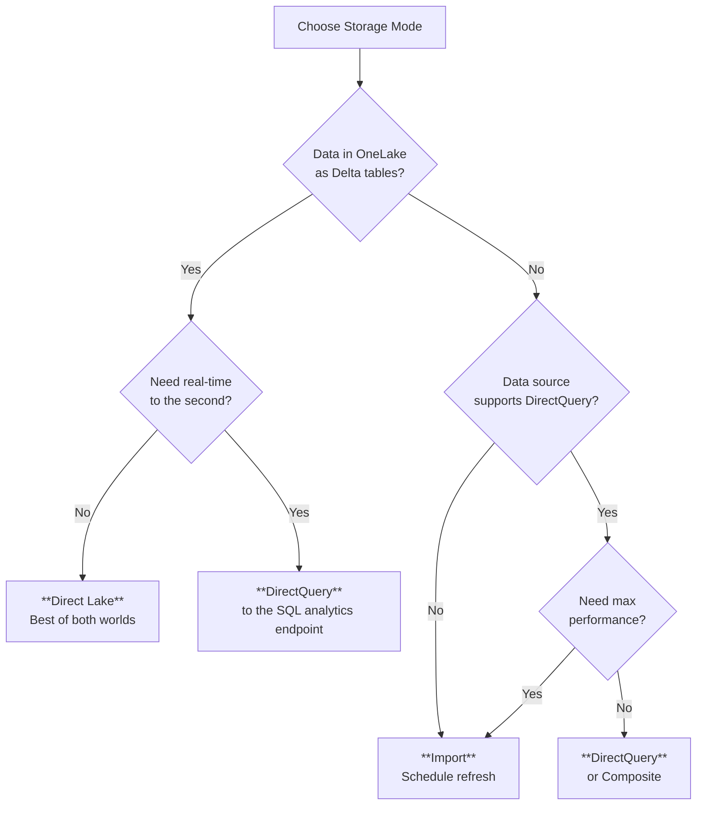
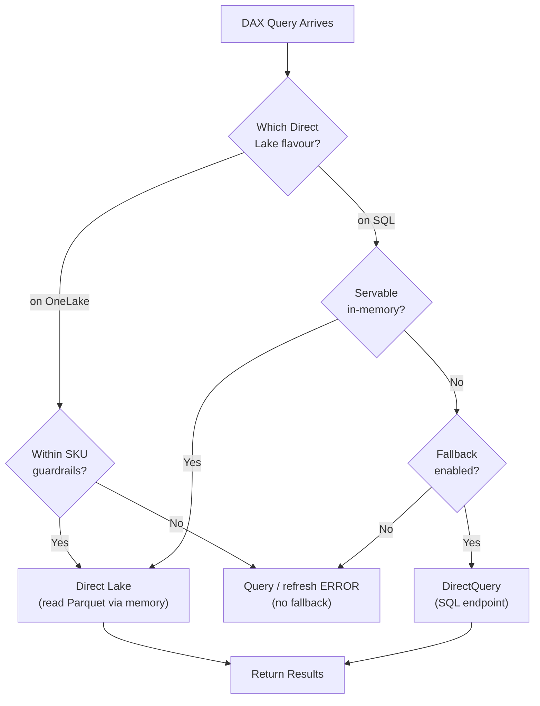

# ⚡ Quick Reference Cheatsheet
{: .no_toc }

> - Based on: *Microsoft Fabric documentation* (Microsoft Learn)
> - 📁 [← Back to Home](/dp-600-study-notes/)

Last-minute review sheet for the DP-600 Microsoft Fabric Analytics Engineer Associate exam. Print it, bookmark it, or skim it in the parking lot.
{: .fs-5 .fw-300 }

<details open markdown="block">
  <summary>Table of contents</summary>
  {: .text-delta }
- TOC
{:toc}
</details>

---

## 🔢 1 — Key Numbers & Limits

| Item | Value / Threshold |
|------|-------------------|
| Max rows per table (Direct Lake, F2–F32) | 300 million |
| Max rows per table (Direct Lake, F64 / P1) | 1.5 billion |
| Max Parquet files per table (Direct Lake, F2 / F64) | 1,000 / 5,000 |
| Max row groups per table (Direct Lake, F2 / F64) | 1,000 / 5,000 |
| Max model size on OneLake (Direct Lake, F2 / F16 / F64) | 10 GB / 20 GB / Unlimited |
| Max memory per model (F2 / F16 / F64) | 3 GB / 5 GB / 25 GB |
| XMLA endpoint availability | Any **F SKU**, P SKU, or **PPU** — default **Read Only**; set **Read Write** in capacity settings |
| Free-license viewers can consume Power BI content | **F64+** (or P SKU); below F64 viewers need Pro/PPU |
| Deployment pipeline stages (max) | **10** (Dev, Test, Prod, plus up to 7 custom stages) |
| Workspace roles | **4**: Admin, Member, Contributor, Viewer |
| Sensitivity labels — who can apply | Users with **Information Protection** license + label publishing policy |
| OneLake file format for Direct Lake | **Delta / Parquet** (V-Order **recommended**, off by default in new workspaces) |
| Max .pbix upload / small-format model size | **10 GB** (large format → up to capacity memory) |
| Max scheduled refreshes per day (Pro) | **8** |
| Max scheduled refreshes per day (Premium) | **48** |

> **Exam Tip:** SKU-specific guardrails (row limits, table counts) are the most common "trick number" questions. Know at least the F2 and F64 tiers.
{: .note }

---

## 💾 2 — Storage Mode Decision Matrix

| Criteria | Import | DirectQuery | Direct Lake | Composite |
|----------|--------|-------------|-------------|-----------|
| **Data freshness** | Scheduled / on-demand refresh | Real-time | Near real-time (framing) | Mixed |
| **Query performance** | Fastest (in-memory) | Depends on source | Fast (columnar from OneLake) | Varies by table |
| **Data volume** | Limited by capacity memory | No size limit | Guardrails per SKU | Mixed |
| **Data source** | Any supported | Any supported | **Delta tables in OneLake only** | Any mix |
| **Licensing** | Any | Any | **Fabric capacity only** | Depends on tables |
| **DAX support** | Full | Full (slower) | Full (calc columns limited) | Full |
| **Use case** | Small-to-mid datasets, max perf | Enforce source RLS, large data | Fabric-native analytics | Migration, mixed sources |
| **Refresh needed?** | Yes | No | Framing only | Partial |



> **Exam Caveat:** Direct Lake is **only** available for Delta tables stored in OneLake (Lakehouse or Warehouse). If data is in Azure SQL or Synapse, you cannot use Direct Lake directly — **mirror** it into Fabric first (mirrored databases expose Delta tables that Direct Lake can read).
{: .warning }

---

## 📐 3 — DAX Quick Reference

### 🔧 CALCULATE & Filter Modifiers

| Pattern | What It Does | Example |
|---------|-------------|---------|
| `CALCULATE(expr, filter)` | Evaluates expression in modified filter context | `CALCULATE(SUM(Sales[Amount]), Product[Color]="Red")` |
| `ALL(table/col)` | Removes all filters from table or column | `CALCULATE(SUM(Sales[Amount]), ALL(Product))` |
| `ALLEXCEPT(table, col)` | Removes all filters except specified columns | `CALCULATE(…, ALLEXCEPT(Product, Product[Category]))` |
| `REMOVEFILTERS(col)` | Alias for ALL — clearer intent | `CALCULATE(…, REMOVEFILTERS(Date[Year]))` |
| `KEEPFILTERS(filter)` | Adds filter without overriding existing context | `CALCULATE(…, KEEPFILTERS(Product[Color]="Red"))` |

### 🔄 Iterators

| Function | Purpose |
|----------|---------|
| `SUMX(table, expr)` | Row-by-row sum |
| `AVERAGEX(table, expr)` | Row-by-row average |
| `COUNTX(table, expr)` | Count rows where expr is not blank |
| `RANKX(table, expr)` | Rank each row by expression |
| `MAXX / MINX` | Row-by-row max/min |

### 📊 Table Functions

| Function | Purpose |
|----------|---------|
| `FILTER(table, condition)` | Returns filtered table (iterator — slower) |
| `ADDCOLUMNS(table, name, expr)` | Adds calculated columns to a table expression |
| `SUMMARIZE(table, groupCol)` | Groups by column(s) — avoid adding measures here |
| `SUMMARIZECOLUMNS(col, filter, name, expr)` | Preferred for grouping + measures (optimized) |
| `SELECTCOLUMNS(table, name, expr)` | Projects specific columns |
| `DISTINCT(col)` | Unique values of a column |
| `VALUES(col)` | Unique values including blank row from broken relationships |

### ⏰ Time Intelligence

| Function | Purpose |
|----------|---------|
| `TOTALYTD(expr, dateCol)` | Year-to-date total |
| `TOTALQTD / TOTALMTD` | Quarter / month-to-date |
| `SAMEPERIODLASTYEAR(dateCol)` | Shifts dates back one year |
| `DATEADD(dateCol, -1, YEAR)` | Shifts dates by interval |
| `DATESYTD(dateCol)` | Returns dates from start of year to current date |
| `PARALLELPERIOD(dateCol, -1, QUARTER)` | Full parallel period |

> **Exam Caveat:** Time intelligence functions require a **contiguous Date table** marked as a date table. Gaps in dates break these functions.
{: .warning }

### 🪟 DAX Window Functions

| Function | Purpose |
|----------|---------|
| `OFFSET(n, relation, orderBy)` | Access row N positions away |
| `WINDOW(from, to, relation, orderBy)` | Define a sliding window |
| `INDEX(n, relation, orderBy)` | Access the Nth row |

### 📌 Variables Pattern & USERELATIONSHIP

```dax
-- VAR / RETURN pattern (always prefer for readability & performance)
Profit Margin =
VAR TotalRevenue = SUM(Sales[Revenue])
VAR TotalCost   = SUM(Sales[Cost])
RETURN
    DIVIDE(TotalRevenue - TotalCost, TotalRevenue, 0)

-- USERELATIONSHIP for role-playing dimensions
Ship Date Sales =
CALCULATE(
    SUM(Sales[Amount]),
    USERELATIONSHIP(Sales[ShipDateKey], Date[DateKey])
)
```

> **Exam Tip:** `USERELATIONSHIP` activates an **inactive** relationship for that measure only. The relationship must already exist in the model as inactive.
{: .note }

---

## 🔒 4 — Security Layers Cheatsheet

| Layer | RLS (Row-Level Security) | CLS (Column-Level Security) | OLS (Object-Level Security) |
|-------|--------------------------|-----------------------------|-----------------------------|
| **What it restricts** | Rows visible to user | Columns a user can query | Tables or columns — data **and** metadata |
| **Semantic model** | DAX filter on a role | = **OLS on columns** | `metadataPermission: none` on table/column |
| **Warehouse / SQL endpoint** | `CREATE SECURITY POLICY` + predicate fn | `GRANT SELECT ON t(cols)` | `GRANT` / `DENY` on objects |
| **Lakehouse files/tables** | OneLake security role row filter | OneLake security role column selection | OneLake security role scope |
| **Semantic-model tooling** | Desktop "Manage roles", web modeling, TMDL, Tabular Editor | TMDL view (Desktop) / Tabular Editor | TMDL view (Desktop) / Tabular Editor |
| **Works with Direct Lake?** | ✅ (model RLS) | ✅ (model OLS) | ✅ |
| **Test method** | "View as" (Desktop) / "Test as role" (service) | Same | Same |

```mermaid
flowchart LR
    subgraph "Security Enforcement Stack"
        A["Workspace Roles<br/>(Admin, Member,<br/>Contributor, Viewer)"] --> B["Semantic Model<br/>RLS / CLS / OLS"]
        B --> C["Sensitivity Labels<br/>(Microsoft Purview)"]
    end
    style A fill:#1a3a5c,stroke:#4a9eff
    style B fill:#1a3a5c,stroke:#4a9eff
    style C fill:#1a3a5c,stroke:#4a9eff
```



> **Exam Caveat:** Semantic-model RLS lives in the **semantic model**; Warehouse/SQL-endpoint RLS and OneLake security RLS are **separate** layers. In every case, workspace **Admin, Member, and Contributor** roles are **never** filtered — only **Viewers** (and read/build-only consumers via apps or sharing) are subject to RLS/OLS.
{: .warning }

---

## 🗄️ 5 — Data Store Selection

| Criteria | Lakehouse | Warehouse | Eventhouse (KQL DB) | SQL database |
|----------|-----------|-----------|---------------------|--------------|
| **Query language** | Spark SQL, PySpark (+ read-only T-SQL) | T-SQL | KQL (+ T-SQL subset) | T-SQL |
| **Storage** | Delta (Parquet) in OneLake | Delta (Parquet) in OneLake (T-SQL–managed) | Columnar KQL store; Delta copy is **opt-in** (OneLake availability) | Row store, auto-mirrored to Delta in OneLake |
| **Best for** | Data engineering, ML, ELT | Enterprise BI, complex joins, stored procs | Streaming, logs, telemetry, time series | OLTP / operational apps |
| **Schema** | Schema-on-read & schema-on-write | Schema-on-write (strict) | Schema-on-write, semi-structured (`dynamic`) columns | Schema-on-write, enforced constraints |
| **Transactions** | ACID per table (Delta) | Multi-table T-SQL transactions | Append-optimized | Full OLTP transactions |
| **SQL analytics endpoint?** | ✅ (read-only) | Native | ✅ when OneLake availability is on | ✅ (read-only, over the mirrored Delta) |
| **Direct Lake support** | ✅ | ✅ | ✅ via OneLake availability | ✅ |

> **Exam Tip:** If the question mentions **T-SQL stored procedures** or **views with complex joins**, the answer is **Warehouse**. If it mentions **streaming** or **IoT telemetry**, think **Eventhouse / KQL Database**. If it mentions an **operational/OLTP** app, think **SQL database in Fabric**.
{: .note }

---

## 📥 6 — Ingestion Method Selection

| Criteria | Dataflow Gen2 | Notebook (Spark) | Copy activity (Pipeline) | Copy job | Mirroring | Shortcut |
|----------|---------------|-------------------|--------------------------|----------|-----------|----------|
| **Skill level** | Low-code (Power Query) | Pro-code (Python/Scala) | Low-code (config) | No/low-code | No-code | No-code |
| **Transformation** | ✅ (M / Power Query) | ✅ (full Spark) | Minimal (mapping) | Minimal (mapping) | None | None (pass-through) |
| **Best for** | Self-service transforms | Complex ETL, ML prep, large data | Orchestrated, metadata-driven loads | Bulk / incremental / CDC copy without a pipeline | Continuous replica of an operational DB | Virtualized access, zero-copy |
| **Scheduling** | Own schedule or pipeline | Schedule or pipeline | Pipeline triggers | Built-in schedule | Continuous | Always live |
| **Writes Delta?** | ✅ | ✅ | ✅ | ✅ | ✅ (read-only replica) | ❌ (reads in-place) |

> **Exam Caveat:** **Shortcuts** do not copy data — they create a virtualized reference. Data stays in the source (ADLS, S3, or another OneLake location). This is critical for questions about data residency and latency.
{: .warning }

---

## 🔷 7 — Direct Lake Deep Dive

### 📌 Key Facts

| Fact | Detail |
|------|--------|
| Required format | **Delta tables** in OneLake (**V-Order recommended**, not required) |
| Where data lives | **OneLake** (Lakehouse or Warehouse) |
| Framing | Snapshot of Delta log metadata; determines which Parquet files to read |
| Refresh type | **Framing** (lightweight metadata update, not data copy) |
| Automatic updates | Auto-reframe when Fabric detects Delta data/schema changes → near-real-time with no schedule |
| On-demand reframe | Via XMLA endpoint, Fabric refresh API, or pipeline (when auto-updates is off) |
| Fallback behavior | **Direct Lake on SQL** only — falls back to **DirectQuery** via SQL endpoint. **Direct Lake on OneLake never falls back** (query/refresh errors instead) |
| Fallback triggers (SQL flavour) | SQL view, SQL-based RLS/CLS, guardrails exceeded, unsupported scenario |
| Disable fallback | `DirectLakeBehavior = DirectLakeOnly` (query errors instead of going to DQ) |
| V-Order | Write-time Parquet optimization; big win for Direct Lake cold-cache queries. **Off by default** in new workspaces (`writeHeavy` profile) — enable it or use `readHeavyForPBI` |



### 🔀 On OneLake vs On SQL Analytics Endpoint

| Aspect | Direct Lake **on OneLake** | Direct Lake **on SQL** |
|--------|---------------------------|------------------------|
| **Connector** | Azure Data Lake Storage (OneLake) | SQL Server / `OneLake.SqlAnalytics` |
| **Data sources per model** | Multiple Fabric items (many lakehouses/warehouses) | Single lakehouse/warehouse |
| **DirectQuery fallback** | ❌ Never (errors instead) | ✅ Yes (unless disabled) |
| **Composite with Import/DQ** | ✅ Yes | ❌ No (only via a new composite in Desktop) |
| **SQL-endpoint RLS/CLS/OLS** | ❌ Not applied (uses OneLake security) | ✅ Enforced (delegated identity) |
| **SQL views as tables** | ❌ (use a materialized lake view / Import) | ✅ but falls back to DirectQuery |
| **Created from** | Service (OneLake catalog), Desktop, SQL endpoint page | SQL analytics endpoint page only |
| **Guardrail exceeded** | Refresh fails; not queryable | Refresh warns; queries fall back to DQ |

> **Exam Caveat:** Direct Lake **does not import data** into the model — it reads Parquet from OneLake into memory on demand, and a "refresh" is just **framing** (metadata pointer). The **on OneLake vs on SQL** distinction (fallback, multi-source, composite, security) was added in the July 2026 revision and is still current as of the October 19, 2026 revision.
{: .warning }

---

## ⚠️ 8 — Common Exam Traps

1. **RLS is defined in the semantic model**, not in the Lakehouse, Warehouse, or data source.
2. **Direct Lake requires Delta tables in OneLake** — no CSV, no Azure SQL, no external Parquet.
3. **Viewers cannot build reports** on shared semantic models without **Build permission**.
4. **Workspace Admin, Member, and Contributor roles are never filtered by RLS/OLS** — they have edit access to the model, however they open the content; only **Viewers** and read/build-only consumers (apps, sharing) are filtered.
5. **XMLA endpoints** work on **any F SKU**, P SKU, or **PPU** — not Pro. They default to **Read Only**; a capacity admin must switch them to **Read Write** for Tabular Editor / deployment tools.
6. **Deployment pipelines** compare content between stages — they do **not** version-control code (use Git integration for that).
7. **Incremental refresh** in Import mode creates partitions automatically — you configure the `RangeStart` and `RangeEnd` parameters, not partition logic.
8. **Sensitivity labels** require **Microsoft Purview Information Protection**; they're inherited downstream and travel with exports (Excel, PDF, PowerPoint).
9. **SUMMARIZE should not be used to add new measure columns** — use `SUMMARIZECOLUMNS` or `ADDCOLUMNS(SUMMARIZE(...))` instead.
10. **Composite models** can mix Import and DirectQuery tables. **Direct Lake on OneLake** tables **can** now be mixed with Import tables in one model (web modeling / Desktop live edit); **Direct Lake on SQL** cannot — you'd build a new composite on top of it in Desktop.
11. **Shortcuts are read-only** virtual references — they do not move, copy, or transform data.
12. **OLS (incl. column security) has no point-and-click UI in Power BI Desktop** — script it in Desktop's **TMDL view** or use Tabular Editor. "Only external tools can do it" is outdated.
13. **Time intelligence functions require a Date table** marked as a date table with no gaps.
14. **V-Order** is a write-time optimization — applied when data is written (or by `OPTIMIZE ... VORDER`), not at query time — and it's **off by default** in new workspaces.
15. **`KEEPFILTERS`** does not remove context; it **intersects** with existing filters. Contrast with `CALCULATE` which overrides.
16. **Direct Lake fallback to DirectQuery** happens **only with Direct Lake on SQL** (via the SQL analytics endpoint). **Direct Lake on OneLake never falls back** — over-guardrail/unsupported queries error and refresh fails instead.
17. **Git integration** in Fabric works at the **workspace level**, not at individual item level.
18. **Dataflow Gen2** writes to **data destinations** (Lakehouse, Warehouse, KQL DB, SQL database, Azure SQL, …); legacy **Gen1** dataflows only keep data in their own storage for semantic models to connect to.
19. **`USERELATIONSHIP`** only works with **inactive** relationships — you cannot reference a relationship that does not exist.
20. **Large format semantic models** (over 10 GB) require Fabric/Premium capacity or PPU — Pro models are capped at 1 GB.
21. **Warehouse** supports `MERGE` (GA) and `BIGINT IDENTITY` keys (no seed/increment, not sequential) — but **no materialized views** (use a Lakehouse **materialized lake view**).
22. **Default semantic models are gone** — since Sept 2025 a new lakehouse/warehouse does **not** auto-create one; create the semantic model explicitly.
23. **Endorsement has three badges**: Promoted (anyone with write permission), Certified, and Master data (admin-authorized users only).

> **Exam Tip:** When two answers both seem correct, ask yourself: "Where is this configured?" The exam loves testing whether something is set in the semantic model, the workspace, the data source, or the admin portal.
{: .note }

---

## ✅ 9 — Pre-Exam Checklist

### 🔒 Domain 1 — Maintain a Data Analytics Solution (25-30%)

- [ ] I can explain the four workspace roles and their permissions
- [ ] I know how deployment pipelines compare content across stages
- [ ] I understand Git integration scope (workspace-level, supported item types)
- [ ] I can configure sensitivity labels and explain downstream inheritance
- [ ] I know when to use XMLA endpoints and which SKUs support read vs. read/write
- [ ] I can describe the difference between RLS, CLS, and OLS and where each is configured (semantic model vs Warehouse/SQL endpoint vs OneLake security)
- [ ] I understand that RLS/OLS never apply to workspace Admins, Members, or Contributors
- [ ] I know the three endorsement badges and who can apply each
- [ ] I know the PBIP folder layout (PBIR report + TMDL model) and deployment-pipeline permissions/rules

### 🔄 Domain 2 — Prepare Data (45-50%)

- [ ] I can choose between Lakehouse, Warehouse, Eventhouse, and SQL database
- [ ] I know when to use Dataflow Gen2 vs. Notebook vs. Pipeline Copy activity vs. Copy job vs. Mirroring vs. Shortcut
- [ ] I can design a star schema with fact and dimension tables
- [ ] I understand how Shortcuts work and their limitations (read-only, no transformation)
- [ ] I can select, filter, and aggregate with the Visual query editor, T-SQL, KQL, and DAX (`EVALUATE` in DAX query view)
- [ ] I can explain OneLake integration for Eventhouse (OneLake availability) and for semantic models (Import tables exported to Delta)
- [ ] I can describe Delta Lake format, V-Order (off by default), and their role in Direct Lake

### 📐 Domain 3 — Implement and Manage Semantic Models (25-30%)

- [ ] I can choose between Import, DirectQuery, Direct Lake, and Composite storage modes
- [ ] I can choose between **Direct Lake on OneLake** and **Direct Lake on SQL analytics endpoint** (multi-source, composite, fallback, SQL-endpoint security)
- [ ] I know the Direct Lake guardrails, framing/refresh (auto-updates) process, and fallback behavior (SQL flavour only)
- [ ] I can write CALCULATE with ALL, ALLEXCEPT, REMOVEFILTERS, and KEEPFILTERS
- [ ] I understand iterator functions (SUMX, AVERAGEX, COUNTX, RANKX)
- [ ] I know when to use SUMMARIZECOLUMNS vs. SUMMARIZE
- [ ] I can implement time intelligence with a proper Date table
- [ ] I understand USERELATIONSHIP for role-playing dimensions
- [ ] I can configure RLS with DAX and test it with "View as" (Desktop) / "Test as role" (service)
- [ ] I know the incremental refresh parameter pattern (`RangeStart` / `RangeEnd`) and when large semantic model format is needed
- [ ] I can create calculation groups, dynamic format strings, and field parameters in Power BI Desktop
- [ ] I know how to optimize a model (remove unused columns, avoid bi-directional filters, use variables)

---

> **Exam Tip:** The DP-600 is heavily weighted toward **Domain 2 (Prepare Data)** at 45-50%. Spend the most study time on data ingestion patterns, star schema design, and query languages.
{: .note }

---

[← 03 — Implement and Manage Semantic Models](/dp-600-study-notes/03-implement-manage-semantic-models/) | [Appendix A — KQL Reference →](/dp-600-study-notes/05-appendix-kql-reference/)